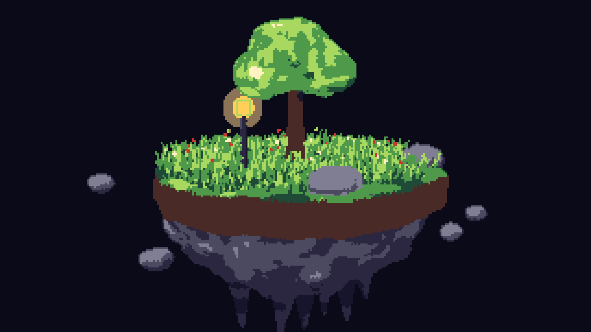
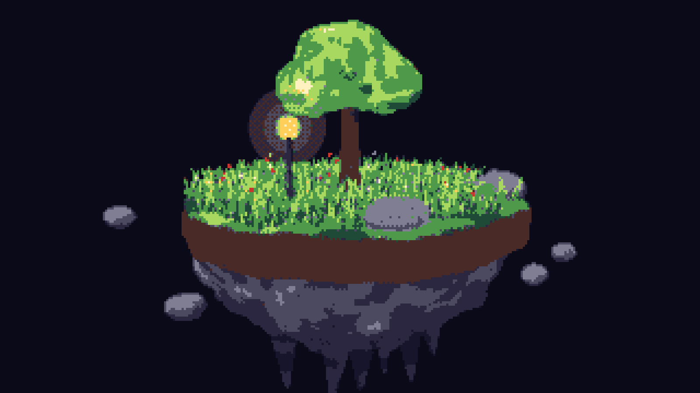

# Pixel Art Splats

Gaussian surfels drawn as pixel art, in URP.

A surface becomes a cloud of flat shaded discs — **surfels**. Each disc stores its own normal, so it
can be lit; the whole cloud is then drawn at twice the art resolution with the Gaussian falloff
switched off, and a fullscreen pass votes every 2×2 block of samples into one flat palette colour.
Real 3D that reads as pixel art: crisp silhouettes, ink outlines, a small palette, none of the soft
splat mush.



## Requirements

- Unity 2022.3 or newer
- URP 14 or newer, and the project must actually use it (the look is a renderer feature)

## Install

- **Tarball**: Window → Package Manager → `+` → *Add package from tarball…*
- **Local folder**: *Add package from disk…*, or drop the folder into `Packages/` to embed it
- **Git**: *Add package from git URL…*

Then run the install menu once, so the pass is registered in your URP renderers:

```
Pixel Art Splats → Setup → Install Renderer Feature
```

It walks every `UniversalRendererData` in `Assets/` and appends the feature. No effect on cameras
that do not have `Pixel Art Settings`, so it is safe to leave installed.

## Quick start

1. Create a palette: `Assets → Create → Pixel Art Splats → Palette`. Hex strings in display space;
   the background must be one of the surface colours.
2. Put `Pixel Art Settings` on the camera and assign the palette.
3. Put `Splat Renderer` on a GameObject and give it a splat cloud. No cloud yet? Use the sample, or:
   - `Pixel Art Splats → Demo → Build Hello Island` — builds the sample scene from code (~15 s)
   - select a mesh → `Pixel Art Splats → Bake → Bake Selected Meshes To Splat Cloud`
4. Press Play. Drag to orbit, scroll to zoom.

`Pixel Art Splats → Render Still` renders the current camera to a PNG in the temp folder, which is
handy for looking at the result without squinting at the Game view.

## The look

All on `Pixel Art Settings`:

| Field | What it does |
|---|---|
| `pixelSize` | Screen pixels per art pixel. Fixed to the screen: zooming changes what is in a pixel, never its size. |
| `supersample` | Draw at 2× the art resolution, four samples per pixel, voted over. Off = one sample. |
| `crisp` | Hard-edged discs and nearest-sampled palette colours. Off = soft Gaussians, blended. |
| `outline` | A solid pixel next to the background takes a darker ink of its own colour. |
| `quantise` | Snap every pixel to the palette. Off shows continuous colour. |
| `dither` | 4×4 ordered (Bayer) dithering between the two nearest palette colours. 0 = off. |
| `minTexels` | Grows tiny distant splats so surfaces do not fall apart. |
| `debugRawSplat` | Show the small splat render on its own, without the pixel pass. |



*The same scene with `dither` at 0.7: shadows break up into a two-colour checker instead of a hard
step.*

`Splat Renderer` holds the cloud plus the live-lighting knobs — `exposure`, `bands` (flat cel steps),
`fog`, `cullBackfaces`. They only affect splats that are not baked: imported meshes, mostly, since
baked scenes already carry their light.

## Data

A splat cloud is a `SplatCloudAsset`: a count, a binary blob (64 bytes per surfel), a spacing and
bounds. Surfels are stored **opaque first, translucent light second**, so the renderer draws them in
two calls without sorting anything.

Each surfel:

| Field | Meaning |
|---|---|
| `pos` | centre, in the renderer's local space |
| `axis1`, `axis2` | the two wide axes of the disc; their **length is the radius** |
| `normal` | the thin axis, i.e. the surface normal |
| `color` | display-space colour (what the palette holds), or the final colour if baked |
| `flags` | emissive, two-sided, glow, baked, up-normal, sway + an alpha byte |

`SurfelFactory.Disc / FromAxes / Scaled` build them.

## Authoring

- **Scenes from code** — `Editor/HelloScene.cs` is a complete worked example: `Sdf` / `Shape` for
  geometry, a `Paint` function per material number, `SurfaceSampler.Sample` to walk the surface, and
  `LightBaker.Shade` to bake sun shadows, lamps and palette ramps. Copy it, change the shapes.
- **Meshes** — `SurfelBaker.FromMeshes` scatters by triangle area (lattice on large triangles,
  jittered samples on small ones) and takes colour from material × texture × vertex colour. Textures
  need Read/Write enabled in their import settings, otherwise only the material colour is used.
- **Your own data** — build a `Surfel[]` and hand it to `SurfelBaker.CreateCloud` (editor) or upload
  it to a `ComputeBuffer` yourself at runtime.

## Where things live

```
Runtime/   Surfel, SplatCloudAsset, SplatRenderer, PixelArtPalette, PixelArtSettings,
           PixelArtSplatFeature, OrbitCamera        → PixelArtSplats.Runtime.dll
Editor/    SdfTools, HelloScene, LightBaker, SurfelBaker, PixelArtSetup → PixelArtSplats.Editor.dll
Shaders/   SurfelSplat (+ .hlsl), PixelArtComposite
Samples~/  Hello Island
```

## Limits

- The pass runs at `AfterRenderingPostProcessing` and **replaces the whole picture**. Other geometry
  in the same camera is overwritten; use a separate camera if you need to mix splats with meshes.
- Render scale should stay at 1: `pixelSize` is in screen pixels.
- One `Splat Renderer` per cloud; all of them share one low-resolution buffer and one depth buffer.
- Not ported from the original: particles, skinned animation, automatic palettes from a model's
  colours, light shaft data. See [How it works](port-notes.md).

## License

MIT. The technique and the ported shader logic come from
[pixelart-gaussiansplat](https://github.com/cobanov/pixelart-gaussiansplat) (MIT, © Mert Cobanov).
