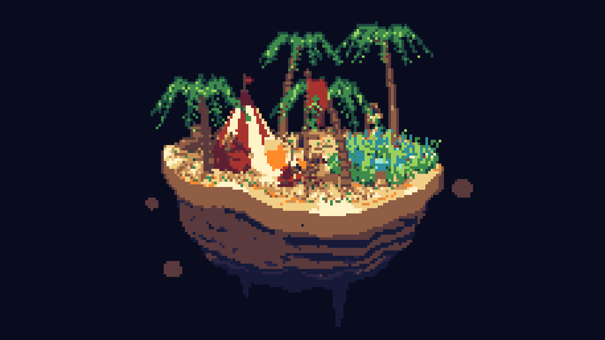

# Pixel Art Splats

Gaussian surfels drawn as pixel art, in URP.

A surface becomes a cloud of flat shaded discs (`surfels`). Each disc carries its own normal, so it
can be lit; then the whole cloud is drawn at twice the art resolution with the Gaussian falloff
switched off, and a fullscreen pass votes every 2×2 block of samples into one flat palette colour.
The result is real 3D geometry that reads as pixel art: crisp silhouettes, ink outlines, a small
palette, no soft splat mush.

| | |
|---|---|
|  | Caravan camp, 147 769 surfels, baked lighting, 16 colours — the same world the [Godot addon](https://github.com/yanhuifair/pixelart-gaussiansplat-godot) ships. |

## Install

Unity 2022.3+ and URP 14+. The project must be using URP: the look comes from a renderer feature, and
the pass replaces the whole picture at the end of the frame.

**Git URL** — Package Manager → `+` → *Add package from git URL…*:

```
https://github.com/yanhuifair/pixelart-gaussiansplat-unity.git
```

Pin a version by appending `#v1.1.0`.

**Tarball** — grab `com.fair.pixelart-splats-1.1.0.tgz` from the
[releases](https://github.com/yanhuifair/pixelart-gaussiansplat-unity/releases) page, then
*Add package from tarball…*.

**Embedded** — clone this repository into your project's `Packages/` folder (or copy the folder
there) and Unity picks it up as an embedded package, editable in place.

Then, once per project, register the pass in your URP renderers:

```
Pixel Art Splats → Setup → Install Renderer Feature
```

Cameras without a `Pixel Art Settings` component render normally, so leaving it installed is safe.

## Quick start

1. **Install the pass** — menu `Pixel Art Splats → Setup → Install Renderer Feature`. It adds the
   feature to every URP renderer in the project (only needs doing once per project; re-running it is
   safe).
2. **Palette** — `Assets → Create → Pixel Art Splats → Palette`, or use the one in the sample.
   Hex strings, in display space. The background must be one of the surface colours.
3. **Camera** — add `Pixel Art Settings` to the camera and set the palette. No settings component,
   no pixel pass: the camera renders normally, so you can mix cameras freely.
4. **Splats** — put `Splat Renderer` on a GameObject and give it a splat cloud. Or make one:
   - select a mesh → `Pixel Art Splats → Bake → Bake Selected Meshes To Splat Cloud`
   - select a `.dio` world (the browser project's format) or a `.bytes` blob →
     `Import .dio Or .bytes As Splat Cloud…`
   - `Pixel Art Splats → Demo → Build Caravan Camp…` rebuilds the sample from its `.dio`
5. Press Play. `Pixel Art Splats → Render Still` renders the current camera to a PNG for a look check.

## The look

Everything on `Pixel Art Settings`:

| Field | What it does |
|---|---|
| `pixelSize` | Screen pixels per art pixel (1..8). Fixed to the screen: zooming changes what is in a pixel, never its size. |
| `supersample` | Draw at 2× the art resolution: four samples per pixel, which the pass votes over. Off = one sample, harder edges, cheaper. |
| `crisp` | Hard-edged discs + nearest-sampled palette colours. Off = soft Gaussians, blended classically. |
| `outline` | A solid pixel next to the background takes a darker ink of its own colour. |
| `quantise` | Snap every pixel to the palette. Off shows the continuous colours. |
| `dither` | Ordered 4×4 Bayer dithering between the two nearest palette colours. 0 = off. |
| `minTexels` | Grows tiny distant splats so surfaces do not fall apart. |
| `debugRawSplat` | Show the small splat render on its own. |

`Splat Renderer` holds the cloud plus live-lighting knobs (`exposure`, `bands` for cel steps, `fog`,
`cullBackfaces`) that only matter for splats that are not baked — imported meshes, mostly.

The same panel the [browser viewer](https://splats.cobanov.dev/) puts over the picture comes with the
package. Two ways to get it:

- **While authoring:** `Pixel Art Splats → Hud` opens it in a dock. It edits the selected camera and
  repaints the views as you drag, so the picture follows in edit mode.
- **While playing:** add `Pixel Art Hud` to the camera. It draws over the game view and takes the
  site's keys — **H** hides it, **Q** palette, **X** hard pixels, **S** 2×2 supersample, **E**
  outline, **O** auto orbit.

> An `OnGUI` on a component is not called every frame in edit mode: Unity only runs it when the game
> view receives an event. That is why the dock exists — and why the overlay can look absent until you
> move the mouse over the game view.

## Authoring

Three ways to get splats:

- **Scenes from code** — `Editor/HelloScene.cs` is a complete example: signed distance shapes via
  `Sdf` / `Shape`, a `Paint` function per material, `SurfaceSampler.Sample` to walk the surface, and
  `LightBaker.Shade` to bake sun shadows, lamps and palette ramps. `SurfelBaker.CreateCloud` writes it
  out. Copy it and change the shapes.
- **Meshes** — `SurfelBaker.FromMeshes` scatters surfels over any triangle mesh by area (lattice on
  big triangles, jittered samples on small ones), taking colour from the material, its texture and
  vertex colours. Textures must be readable (Read/Write enabled in the import settings).
- **Worlds from the browser** — `DioImport.ParseDio` reads a `.dio` (compact positions, int8
  normals, rgb, then the free splats with their scale and quaternion) and `DioImport.Import` writes it
  out as a cloud. It mirrors x on the way in: the browser and Godot are right handed, Unity is left
  handed, and without that a scene comes out back to front.
- **By hand** — build a `Surfel[]` yourself: position, two wide axes (length = radius), normal,
  colour, flags. `SurfelFactory.Disc / FromAxes / Scaled` do the maths.

## What is in the box

```
Runtime/   Surfel, SplatCloudAsset, SplatRenderer, PixelArtPalette, PixelArtSettings,
           PixelArtSplatFeature (the renderer feature and its pass), OrbitCamera, PixelArtHud
Editor/    Sdf + Shape + SurfaceSampler, HelloScene (scene from code), LightBaker,
           SurfelBaker (assets + meshes), DioImport (.dio / .bytes), CaravanDemo (the sample),
           PixelArtSetup (menus)
Shaders/   SurfelSplat (the discs, two passes), PixelArtComposite (the pixel pass + enlarge)
```

## Notes and limits

- The pass runs at `AfterRenderingPostProcessing` and **replaces the whole picture** with the splat
  render. One camera draws splats; other geometry in that camera is overwritten. Use a second camera
  if you need to mix.
- The pixel grid belongs to the screen, so `pixelSize` is in screen pixels. Render scale should stay
  at 1.
- Renderer features from a package cannot bake themselves into the project's URP assets: that is what
  the install menu is for. Run it after installing.
- Splats baked inside Unity are in Unity's coordinates; worlds imported from `.dio` are mirrored on
  the way in, so they read the same as they do in the browser or in the Godot addon.
- Ported from [pixelart-gaussiansplat](https://github.com/cobanov/pixelart-gaussiansplat) (three.js +
  Spark). Not ported: particles, skinned animation, automatic palettes from a model's colours, light
  shafts data. See `Documentation~/port-notes.md`.

## Shipping your own build

`Pixel Art Splats → Package → Pack Tarball` writes `Dist/<name>-<version>.tgz` and reveals it. It
refuses to pack if any asset is missing a `.meta` file: immutable packages (tarball, git, registry)
silently ignore those, and a missing `.asmdef.meta` takes its whole assembly definition with it —
which is exactly how a package that works when embedded stops compiling once packed.

## License

MIT. The technique and the ported shader logic come from pixelart-gaussiansplat, MIT, © Mert Cobanov.
